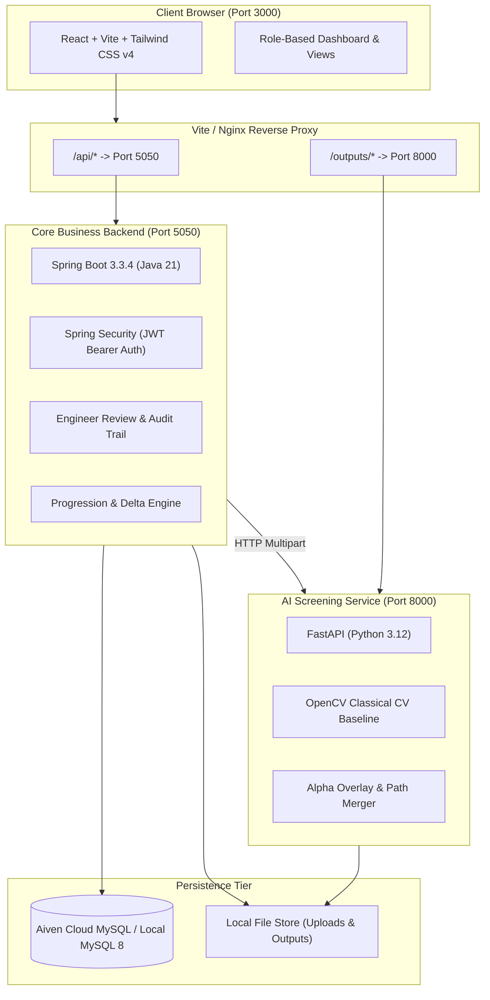

# CrackVision — Structural Crack Detection and Monitoring System

[](https://spring.io/projects/spring-boot)
[](https://react.dev/)
[](https://fastapi.tiangolo.com/)
[](https://tailwindcss.com/)
[](https://www.oracle.com/java/)
[](https://www.python.org/)
[](https://www.docker.com/)

**CrackVision** is an end-to-end, multi-tier structural engineering web platform engineered to assist construction managers, site engineers, and field workers in detecting, classifying, and longitudinally monitoring visible cracks across reinforced concrete infrastructure (columns, beams, slabs, walls, and foundations).

---

## Architecture Overview



---

## Key Modules & Capabilities

1. **Role-Based Access Control (RBAC):**
   - `ADMIN`: Full administrative management (users, projects, hierarchy, certified reviews).
   - `SITE_ENGINEER`: Professional review determinations (`MONITOR`, `INSPECT_FURTHER`, `REQUIRES_FURTHER_ASSESSMENT`, `NO_ACTION_REQUIRED`, `REPAIR_REQUIRED`), longitudinal monitoring analysis.
   - `SITE_WORKER`: Field survey creation, photo uploads, preliminary analysis triggering.
   - `PROJECT_MANAGER`: High-level oversight, structure hierarchy building, status tracking.

2. **Project Structure Hierarchy:**
   - Interactive drilldown: `Project` &rarr; `Building` &rarr; `Floor` &rarr; `Structural Component` &rarr; `Inspection Logs`.

3. **Field Inspections & Secure Photo Upload:**
   - Multi-image upload with client-side preview, file validation (JPEG/PNG/WebP, max 10MB), and authenticated image streaming.

4. **Computer Vision Crack Screening:**
   - Classical edge detection, morphological filtering, and contour path merging using OpenCV.
   - Severity classification: `NORMAL`, `MINOR`, `MODERATE`, `SEVERE`.
   - **Academic Integrity Notice:** The baseline uses classical computer vision algorithms (filtering, contours). No false deep-learning confidence scores are fabricated (`confidence` is explicitly returned as `null` / "Not available").

5. **Longitudinal Component Monitoring & Deltas:**
   - Chronological AI screening history per structural component.
   - Comparative Delta Analysis: Days elapsed, screening category transition, crack area % delta ($\Delta$), candidate region count delta ($\Delta$).
   - Progression trend badges: `AREA_EXPANSION_INDICATED`, `STABLE_SCREENING_METRICS`, `AREA_REDUCTION_INDICATED`, `NEW_DETECTION`, `SINGLE_ANALYSIS_BASELINE`.
   - Responsive SVG trend line chart plotting screening area % and region counts over time.
   - Side-by-side visual photo comparison (AI highlighted overlay vs. original photo).

6. **Engineer Review Audit Trail:**
   - Append-only, tamper-evident determinations logged with the authenticated engineer's credentials.
   - Pending review queue with one-click certification.

7. **Inspection Reports & PDF Export:**
   - Official multi-page printable report with document ID, hierarchy metadata, AI visual screening findings, certified engineer verdict, and statutory engineering disclaimer.
   - Instant PDF generation via browser print engine (`window.print()`).

---

## Role Permissions Matrix

| Feature / Action | ADMIN | SITE_ENGINEER | SITE_WORKER | PROJECT_MANAGER |
| :--- | :---: | :---: | :---: | :---: |
| View Dashboard & Metrics | Yes | Yes | Yes | Yes |
| Explore Structure Hierarchy | Yes | Yes | Yes | Yes |
| Create Projects / Buildings / Floors | Yes | Read-Only | Read-Only | Yes |
| Create Component Inspections | Yes | Yes | Yes | Yes |
| Upload Inspection Photos | Yes | Yes | Yes | Yes |
| Trigger AI Screening Analysis | Yes | Yes | Yes | Yes |
| View Monitoring Timeline & Deltas | Yes | Yes | Yes | Yes |
| Submit Certified Engineer Review | Yes | Yes | Read-Only | Read-Only |
| Print / Export Inspection PDF Reports | Yes | Yes | Yes | Yes |

---

## Running the Application Locally

### Prerequisites
- Java 21 JDK & Maven 3.9+
- Node.js 20+ & npm
- Python 3.12 with `venv`
- MySQL Database (Aiven Cloud or local)

### 1. AI Microservice (Port 8000)
```powershell
cd ai-service
# Activate virtual environment
.\.venv\Scripts\Activate.ps1
# Install dependencies
pip install -r requirements.txt
# Run FastAPI via Uvicorn
python -m uvicorn app.main:app --host 127.0.0.1 --port 8000
```
*Health check:* [http://localhost:8000/health](http://localhost:8000/health)

### 2. Spring Boot Backend (Port 5050)
Configure database credentials via environment variables or `.env`:
```powershell
$env:CRACKVISION_DB_HOST="your-mysql-host.aivencloud.com"
$env:CRACKVISION_DB_PORT="14777"
$env:CRACKVISION_DB_NAME="defaultdb"
$env:CRACKVISION_DB_USER="avnadmin"
$env:CRACKVISION_DB_PASSWORD="your-password"
$env:CRACKVISION_AI_SERVICE_URL="http://127.0.0.1:8000"

cd backend
mvn spring-boot:run
```
*API Root:* [http://localhost:5050/api](http://localhost:5050/api)

### 3. React Frontend (Port 3000)
```powershell
cd frontend
npm install
npm run dev
```
*Web Application:* [http://localhost:3000](http://localhost:3000)

---

## Docker Deployment (Single Command)

CrackVision is fully Dockerized for containerized deployment:

```bash
# 1. Copy environment template and fill in your database credentials
cp .env.example .env

# 2. Build and start all services
docker compose up --build
```

### Services Started:
- **`crackvision-frontend`**: React + Nginx on `http://localhost:3000`
- **`crackvision-backend`**: Spring Boot 3 on `http://localhost:5050`
- **`crackvision-ai-service`**: FastAPI + OpenCV on `http://localhost:8000`

To start with a local containerized MySQL database instead of cloud:
```bash
docker compose --profile local-db up --build
```

---

## Verification & Testing

- **Backend Unit Tests:**
  ```powershell
  cd backend
  mvn test
  ```
- **AI Microservice Unit Tests:**
  ```powershell
  cd ai-service
  .\.venv\Scripts\pytest.exe -v tests
  ```
- **Frontend Linter & Production Build:**
  ```powershell
  cd frontend
  npm run lint
  npm run build
  ```

---

## Engineering Disclaimer
*CrackVision provides automated 2D computer-vision screening metrics for preliminary detection assistance. Numeric deltas and visual classifications do not constitute certified physical crack growth measurements or structural safety certifications. All structural interventions require physical on-site evaluation by a licensed structural engineer.*
